# Lab 2 - Personalized Power BI Agents (édition Claude Code)

⏱️ **Durée totale :** 120 minutes

> [!IMPORTANT]
> Ce lab utilise des prompts avec des outils d'IA. Les réponses peuvent différer des exemples, même avec le même prompt. Après chaque exercice, comparez votre résultat avec le **Résultat attendu** avant de continuer.

## Vue d'ensemble

Vous allez faire du développement Power BI agentique personnalisé avec **Claude Code** et les outils agentiques Power BI de Microsoft (plugin `powerbi-authoring`).

Le lab couvre deux scénarios :

- **Brownfield.** Vous héritez d'un rapport Power BI existant. Vous le convertissez en PBIP, le versionnez avec Git et utilisez Claude Code pour le faire évoluer.
- **Greenfield.** Vous partez d'un Lakehouse Fabric et laissez l'agent planifier puis construire un modèle sémantique et des rapports, en gardant la main sur l'implémentation.

Les deux parties partagent la préparation de l'environnement. Ensuite, elles sont indépendantes.

## Ce que vous allez apprendre

- Installer et utiliser le plugin `powerbi-authoring` dans Claude Code
- Suivre, relire et annuler les changements de l'IA grâce à PBIP et Git
- Guider l'agent avec `CLAUDE.md` / `AGENTS.md` et une skill de projet
- Fournir le contexte métier et les standards d'équipe sous forme de fichiers versionnés
- Modifier un modèle sémantique et un rapport existants avec les skills et outils agentiques Power BI
- Planifier avant d'implémenter, et choisir un modèle pour chaque phase
- Utiliser le MCP distant Power BI Authoring sans installation locale
- Lancer des subagents en parallèle pour produire plusieurs variantes

## Structure du lab

| Section | Objectif |
| --- | --- |
| [Prérequis](#prérequis) | Vérifier les outils, licences et accès |
| [Préparer l'environnement](#préparer-lenvironnement) | Installer le plugin et se connecter |
| **[Partie 1 : Brownfield](#partie-1--brownfield)** | **Faire évoluer un projet Power BI existant** |
| [1.1 Enregistrer en PBIP et versionner avec Git](#11-enregistrer-le-rapport-en-pbip-et-le-versionner-avec-git) | Créer une base relisible |
| [1.2 Préparer le contexte agentique](#12-préparer-le-contexte-agentique) | Ajouter `CLAUDE.md`, `AGENTS.md` et une skill locale |
| [1.3 Documenter le modèle et le rapport](#13-générer-la-documentation-du-modèle-et-du-rapport) | Automatiser une tâche que personne n'aime |
| [1.4 Décrire les mesures avec le contexte métier](#14-ajouter-des-descriptions-de-mesures-avec-le-contexte-métier) | Ancrer l'agent dans le vocabulaire métier |
| [1.5 Conversion de devises par calculation group](#15-ajouter-la-conversion-de-devises-avec-un-calculation-group) | Étendre le modèle sémantique |
| [1.6 Remettre en forme les pages du rapport](#16-remettre-en-forme-les-pages-du-rapport) | Appliquer des changements de mise en page à tout le rapport |
| **[Partie 2 : Greenfield](#partie-2--greenfield)** | **Construire de nouveaux artefacts dans Fabric** |
| [2.1 Préparer le workspace Fabric](#21-préparer-le-workspace-fabric) | Créer la source de données |
| [2.2 Brancher Claude Code au MCP distant](#22-brancher-claude-code-au-mcp-distant) | Travailler sans installation locale |
| [2.3 Planifier et construire une solution complète](#23-planifier-et-construire-une-solution-power-bi-complète) | Un modèle et deux variantes de rapport |

## Prérequis

Commencez par les [prérequis de l'atelier](../pre-requisites.md).

Ce lab nécessite :

* Claude Code, avec un compte Claude actif
* Power BI Desktop (août 2026 ou plus récent), **Windows uniquement**, pour la partie 1
* Git
* Node.js et npm
* Azure CLI
* Un compte Fabric avec accès à une capacité et le droit de créer un workspace
* Facultatif : Visual Studio Code avec l'extension Claude Code

> [!NOTE]
> **Sous Linux ou macOS :** la partie 1 dépend de Power BI Desktop (conversion PBIX → PBIP, **Apply external changes**, captures d'écran via le Desktop Bridge). Faites-la sur une VM ou un poste Windows. La partie 2 fonctionne sur toutes les plateformes.

## Préparer l'environnement

✅ **Objectif** : installer le plugin Power BI authoring une fois pour toutes dans Claude Code, puis se connecter aux comptes dont l'agent a besoin.

### Récupérer les ressources du lab

Clonez ou téléchargez ce dépôt, par exemple dans `C:\FabCon\repo` (ou `~/FabCon/repo`). Les exercices font référence à des fichiers par leur chemin dans le dépôt. Les ressources de ce lab sont dans `./lab2/resources`.

### Installer le plugin Power BI authoring

1. Ouvrez un terminal.
2. Lancez :

	```bash
	claude plugin marketplace add microsoft/skills-for-fabric
	```

	```bash
	claude plugin install powerbi-authoring@fabric-collection
	```

	Vous pouvez aussi le faire depuis une session Claude Code avec `/plugin marketplace add microsoft/skills-for-fabric`, puis `/plugin install powerbi-authoring@fabric-collection`.

3. Vérifiez l'installation :

	```bash
	claude plugin list
	claude mcp list
	```

	Le serveur `powerbi-modeling-mcp` du plugin doit apparaître. C'est le MCP **local**, lancé via `npx @microsoft/powerbi-modeling-mcp`.

> [!TIP]
> Le plugin fournit deux skills (`semantic-model-authoring` et `powerbi-report-cli`) et le MCP local Power BI Modeling. Dans Claude Code, les skills d'un plugin sont préfixées par son nom : `powerbi-authoring:semantic-model-authoring`. Pour recevoir les nouvelles versions : `/plugin` > **Marketplaces** > `fabric-collection` > **Enable auto-update**.
>
> Voir aussi la [documentation `powerbi-authoring`](https://learn.microsoft.com/en-us/power-bi/developer/agentic/power-bi-agentic-overview#get-started).

### Vérifier Claude Code

1. Lancez `claude` dans un terminal.
2. Vérifiez le compte et le modèle avec `/status`.
3. Tapez `/plugin` et confirmez que `powerbi-authoring` est activé.
4. Quittez avec `/exit` (ou `Ctrl+D`).

> [!TIP]
> Si vous préférez VS Code, installez l'extension **Claude Code**. Elle affiche les diffs dans l'éditeur, mais c'est le même agent, avec les mêmes skills, plugins et MCP que dans le terminal.

### Se connecter avec Azure CLI

1. Dans un terminal, connectez-vous avec le compte Fabric :

	```bash
	az login --allow-no-subscriptions
	```

	Le compte Fabric de l'atelier n'a **pas d'abonnement Azure**. Sans `--allow-no-subscriptions`, `az login` affiche `No subscriptions found` et ne crée aucune session : `az account show` répond alors `Please run 'az login'`. Pour cibler directement le tenant de l'atelier :

	```bash
	az login --tenant 64a5d9e8-a2d2-4914-bba4-4840b3732a7c --allow-no-subscriptions
	```

2. Suivez la connexion dans le navigateur, puis revenez au terminal.
3. Vérifiez le compte actif :

	```bash
	az account show
	az account get-access-token --resource https://api.fabric.microsoft.com --query expiresOn -o tsv
	```

	La seconde commande doit afficher une date d'expiration : c'est ce jeton qu'utilisent les outils Power BI et le MCP distant.

	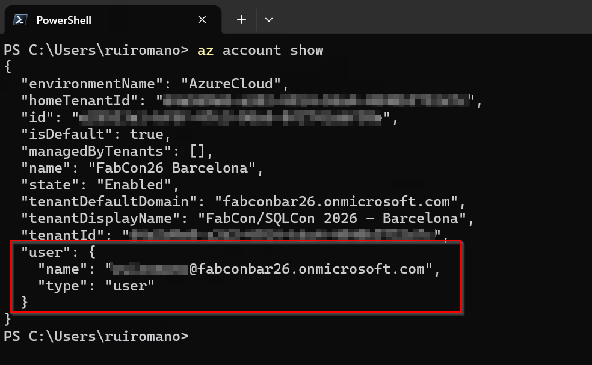

> [!IMPORTANT]
> Les outils Power BI utilisent le jeton Azure CLI pour accéder à Fabric. Si le mauvais compte est actif, les exercices suivants échoueront avec des erreurs d'autorisation. Consultez le [dépannage](../troubleshooting.md).

---

## Partie 1 : Brownfield

Vous travaillez sur un rapport Power BI existant. Vous le convertissez en PBIP, le versionnez avec Git et utilisez Claude Code pour le documenter et le modifier. Gardez Power BI Desktop ouvert pour recharger et inspecter les changements de l'agent.

### 1.1 Enregistrer le rapport en PBIP et le versionner avec Git

✅ **Objectif** : convertir le PBIX fourni en projet PBIP et créer une base Git, pour que chaque changement de l'agent soit relisible et réversible.

#### Étapes

1. Ouvrez [`resources/sales.pbix`](resources/sales.pbix) dans **Power BI Desktop**.
2. **Fichier** > **Enregistrer sous** > **Parcourir cet appareil**. Choisissez le type **Power BI project files (*.pbip)** et enregistrez dans un dossier local, par exemple `C:\FabCon\Lab2_Part1`.

	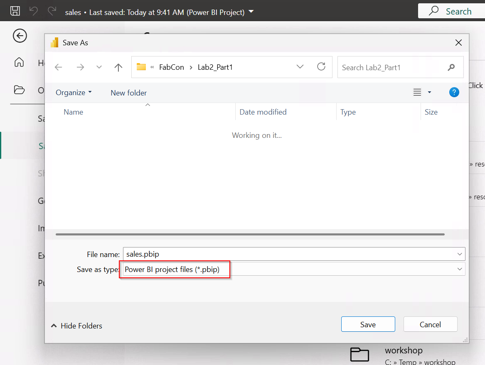

3. Laissez Power BI Desktop ouvert. Vous y rechargerez les changements plus tard.
4. Ouvrez un terminal dans le dossier du projet. Vérifiez qu'il contient `sales.SemanticModel` et `sales.Report`.
5. Initialisez Git et créez le commit de base :

	```powershell
	cd C:\FabCon\Lab2_Part1
	git init
	git add .
	git commit -m "Initial PBIP baseline"
	```

	Si vous utilisez VS Code, **Source Control** (`CTRL+SHIFT+G`) > **Initialize Repository** fait la même chose.

> [!IMPORTANT]
> PBIP stocke le modèle sémantique en TMDL et le rapport en PBIR. Les deux sont du texte, donc Git montre exactement ce que l'agent a changé. C'est votre filet de sécurité : relisez le diff (`git diff`) après chaque prompt, gardez ce qui vous convient et annulez le reste (`git restore .`). Dans Claude Code, `Esc` deux fois (`/rewind`) permet aussi de revenir à un point précédent de la conversation et du code.

### 1.2 Préparer le contexte agentique

✅ **Objectif** : ajouter des instructions versionnées et une skill locale, pour que l'agent sache comment travailler sur ce code avant même le premier prompt.

#### Étapes

1. Depuis `lab2/resources` du dépôt, copiez à la racine du projet PBIP :

	- [resources/CLAUDE.md](resources/CLAUDE.md)
	- [resources/AGENTS.md](resources/AGENTS.md)
	- [resources/company-context.md](resources/company-context.md)
	- le dossier [resources/.claude](resources/.claude), qui contient la skill `powerbi-documentation`

	```powershell
	Copy-Item C:\FabCon\repo\lab2\resources\CLAUDE.md, C:\FabCon\repo\lab2\resources\AGENTS.md, C:\FabCon\repo\lab2\resources\company-context.md .
	Copy-Item C:\FabCon\repo\lab2\resources\.claude . -Recurse
	```

2. Le dossier doit maintenant ressembler à ceci :

	```text
	Lab2_Part1/
	├── .claude/
	│   └── skills/
	│       └── powerbi-documentation/
	│           └── SKILL.md
	├── AGENTS.md
	├── CLAUDE.md
	├── company-context.md
	├── sales.pbip
	├── sales.Report/
	└── sales.SemanticModel/
	```

> [!IMPORTANT]
> Claude Code lit automatiquement `CLAUDE.md` au démarrage de chaque session. Ici, `CLAUDE.md` importe `AGENTS.md` (ligne `@AGENTS.md`). Vous gardez ainsi un seul fichier de règles ([`AGENTS.md`](https://agents.md/)), valable aussi pour les collègues sous Copilot, Codex ou Cursor, et Claude Code le charge.
>
> Le `AGENTS.md` de l'atelier est volontairement simple. Il impose de charger les bonnes skills Power BI et d'utiliser le MCP Power BI Authoring pour modifier le modèle sémantique. L'agent sait éditer les fichiers TMDL directement, mais passer par le MCP est plus fiable et casse moins de choses.
>
> Les skills Microsoft viennent du plugin `powerbi-authoring`. La skill [`powerbi-documentation`](resources/.claude/skills/powerbi-documentation/SKILL.md) est une **skill de projet** : elle vit dans `.claude/skills/`, avec le code, et toute l'équipe en profite via Git.

3. Commitez les nouveaux fichiers. Vous pouvez demander à Claude de le faire et de rédiger le message :

	```bash
	claude "commit the new files with a meaningful message"
	```

### 1.3 Générer la documentation du modèle et du rapport

✅ **Objectif** : laisser l'agent produire la documentation que personne n'écrit jamais, en prenant les fichiers PBIP comme source de vérité.

Écrire une documentation et la tenir à jour prend du temps. L'IA fournit un bon point de départ. Les outils agentiques Power BI (le MCP et la CLI `powerbi-desktop`) permettent ensuite de la garder alignée sur le modèle et le rapport.

#### Étapes

1. Dans le dossier du projet, lancez Claude Code :

	```bash
	claude
	```

2. Choisissez le modèle avec `/model` : **Opus**, effort **medium**.

> [!IMPORTANT]
> **Choisissez le modèle et l'effort de réflexion selon la complexité de la tâche.**
>
> | Original | Équivalent Claude | Usage |
> | --- | --- | --- |
> | GPT-6 Sol | **Opus** | Tâches complexes : raisonnement, planification, validation |
> | GPT-6 Luna | **Sonnet** ou **Haiku** | Tâches simples, bien cadrées et répétitives |
>
> L'**effort** se règle séparément dans `/model`. Un effort plus élevé améliore les tâches complexes, mais coûte plus cher. Vous pouvez aussi lancer directement `claude --model opus`.
>
> **Règle générale :** commencez avec le modèle le moins cher qui fait le travail de façon fiable, et montez en gamme si la tâche demande plus de raisonnement.
>
> À lire : [Tabular Editor - Pick the right AI model](https://tabulareditor.com/blog/picking-the-ai-model-for-the-task).

3. Saisissez le prompt :

	```text
	Document this Power BI Project code base.
	```

	**Résultat attendu**

	- L'agent lit `CLAUDE.md` (et donc `AGENTS.md`) et charge la skill locale `powerbi-documentation`.
	- Il suit la structure et les standards de documentation de cette skill.
	- Il charge les skills modèle sémantique et rapport du plugin `powerbi-authoring`, qui expliquent comment lire et analyser les métadonnées.
	- Il utilise le MCP Power BI Authoring (outils `mcp__plugin_powerbi-authoring_powerbi-modeling-mcp__…`) pour inspecter le modèle.
	- Il utilise la CLI de rapport Power BI pour capturer des écrans du rapport ouvert dans Power BI Desktop.
	- Un dossier `docs/` est créé, avec un catalogue et un fichier Markdown par modèle sémantique et par rapport.
	- La documentation couvre la structure du modèle, les mesures, le parcours du rapport, les filtres et une capture de chaque page.

> [!IMPORTANT]
> Un prompt aussi court suffit parce que `AGENTS.md` oblige l'agent à charger la skill `powerbi-documentation`. La skill décrit comment l'équipe veut sa documentation. Le MCP Power BI et les outils de rapport fournissent les informations nécessaires. `AGENTS.md` demande aussi de toujours passer par le MCP plutôt que d'éditer les fichiers TMDL à la main.

4. Par défaut, Claude Code demande votre accord avant chaque outil qui modifie des fichiers, lance une commande ou appelle un MCP. Relisez l'outil et ses paramètres avant d'accepter. Pour chaque demande, vous pouvez :

	- **Yes** : autoriser une fois ;
	- **Yes, and don't ask again** : autoriser cet outil ou cette commande pour le reste de la session et du projet ;
	- **No** : refuser, et dire à Claude ce qu'il doit faire à la place.

	**Interactif ou autonome**

	`Shift+Tab` fait défiler les modes de permission (le mode actif s'affiche sous la zone de saisie) :

	- **Default** : l'agent s'arrête pour votre accord. Par exemple : `Agent → action → vous demande → Agent → action → vous demande`.
	- **Accept edits** : les modifications de fichiers sont acceptées automatiquement. Les commandes et les appels MCP restent soumis à accord.
	- **Auto mode** : l'agent enchaîne jusqu'au bout, y compris les réessais et la validation, sans s'arrêter à chaque étape. Par exemple : `Agent → action → action → erreur → correction → action → validation → terminé`. C'est l'équivalent de l'**Autopilot** de Copilot.
	- **Plan mode** : lecture seule, l'agent propose un plan sans rien modifier (partie 2).

> [!IMPORTANT]
> Les modes autonomes (*auto mode*, *accept edits*, ou `--dangerously-skip-permissions` qui équivaut à **Allow all**) suppriment des confirmations, y compris pour les modifications de fichiers, les commandes et les appels d'outils externes. Réservez-les à un dossier de confiance, versionné par Git, et en connaissant les implications de sécurité. Vous pouvez aussi pré-autoriser des outils précis dans `.claude/settings.json` (`permissions.allow`) plutôt que tout autoriser. Voir [Permissions in Claude Code](https://code.claude.com/docs/en/iam).

5. Ouvrez et relisez les fichiers générés dans `docs/`. Dans VS Code, `Ctrl+Shift+V` affiche l'aperçu Markdown.
6. Commitez tous les changements.

#### Réflexion

* Combien de temps vous faudrait-il pour produire une documentation de ce niveau sur l'un de vos propres modèles ?
* Quels standards votre équipe ajouterait-elle à la skill `powerbi-documentation`, ou en retirerait-elle ?
* Quelles parties de la documentation générée doivent encore être vérifiées par un humain ?

### 1.4 Ajouter des descriptions de mesures avec le contexte métier

✅ **Objectif** : donner à chaque mesure une description claire pour le métier, dans le vocabulaire de Northwind Retail Group et non dans un jargon BI générique.

#### Étapes

1. Démarrez une **nouvelle session** : `/clear`, ou quittez et relancez `claude`. Choisissez **Sonnet** avec `/model`, effort **medium**.

> [!IMPORTANT]
> Générer des descriptions de mesures existantes est une tâche bien cadrée et répétitive. Un modèle moins cher comme **Sonnet** (voire **Haiku**) convient parfaitement.

> [!TIP]
> Changez de session quand vous changez de tâche. Une session propre évite que les décisions, hypothèses et résultats d'outils de la tâche précédente influencent la suivante. Vous pouvez aussi reprendre une session existante avec `/resume` (ou `claude --continue`) pour garder son contexte. Par exemple, reprenez la session de documentation pour mettre à jour la doc après avoir modifié le modèle.

2. Saisissez le prompt :

	```text
	Add a description to every measure in the semantic model `Sales.SemanticModel\definition`.
	Use `company-context.md` for tone and business context so descriptions sound like they come from someone at Northwind Retail Group, not generic BI text.
	Keep each description to 1-2 sentences: what the measure calculates, and any business nuance from the context (e.g. net vs. gross, fiscal year, seasonality) where relevant.
	```

	> [!TIP]
	> Avec `@company-context.md` au lieu du simple nom, Claude Code ajoute directement le fichier au contexte.

	**Résultat attendu**

	- L'agent charge la skill `semantic-model-authoring`.
	- Il se connecte aux fichiers TMDL via le MCP Power BI Authoring, au lieu de les éditer à la main.
	- Chaque mesure reçoit une description concise d'une à deux phrases.
	- Les descriptions reprennent le contexte : le chiffre d'affaires décrit comme des ventes nettes, les exercices notés FY24 ou FY25, les effets saisonniers signalés quand c'est pertinent.
	- Le modèle mis à jour est enregistré dans le dossier PBIP.
	- Aucune expression de mesure, aucun type de données et aucune relation n'est modifié.

> [!TIP]
> Il y a peu de différence entre `company-context.md` et le contenu d'une skill : ce contexte pourrait tout à fait devenir une skill. L'exercice le garde en fichier simple pour montrer qu'on peut aussi donner du contexte à l'agent en citant un fichier dans le prompt.

3. Dans **Power BI Desktop**, cliquez sur **Apply external changes** pour charger les modifications de l'agent.

	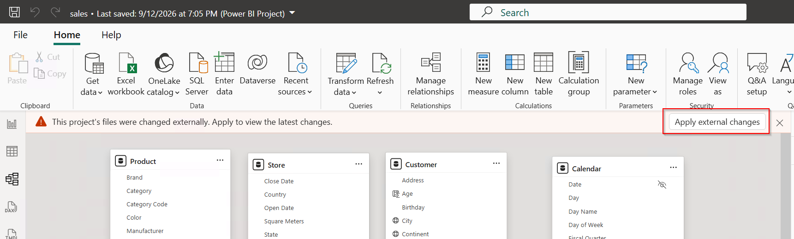

> [!TIP]
> **Apply external changes** est arrivé avec la version d'août 2026 de Power BI Desktop. Il détecte et recharge les fichiers PBIP modifiés hors de Desktop, que ce soit à la main ou par un agent. Voir [Edit Power BI Desktop project files in Visual Studio Code](https://learn.microsoft.com/en-us/power-bi/developer/projects/projects-external-editing).
>
> Si la bannière n'apparaît pas, activez **Enable external tool access to Power BI Desktop through secure local APIs** dans **Fichier** > **Options** > **Sécurité**. Avant la version de septembre 2026, cette option se trouve dans **Fonctionnalités en préversion**.

4. Sélectionnez une mesure dans la vue modèle et relisez sa description, nourrie par [`company-context.md`](resources/company-context.md).
5. Relisez le diff Git :

	```bash
	git diff -- '*.tmdl'
	```

	Vérifiez que seules des propriétés `description` ont changé et qu'aucune expression DAX n'a été touchée. Puis **commitez**.

	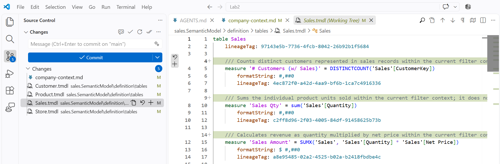

> [!TIP]
> C'est tout l'intérêt de PBIP avec Git : vous voyez le changement exact avant de l'accepter. Vous pouvez aussi demander à Claude : `review the git diff and confirm only descriptions changed`.

#### Réflexion

* Quelles autres connaissances d'équipe mériteraient d'être stockées comme fichier de contexte dans le dépôt ?
* Sans Git, comment sauriez-vous exactement ce que l'agent a modifié ?
* Comment annuler vite et sans risque un changement de l'agent qui donne un mauvais résultat ?

### 1.5 Ajouter la conversion de devises avec un calculation group

✅ **Objectif** : étendre le modèle avec une nouvelle table issue d'un CSV et un calculation group, pour analyser les ventes dans plusieurs devises.

#### Étapes

1. Démarrez une **nouvelle session** (`/clear`) et choisissez **Opus**, effort **medium**.

2. Saisissez le prompt :

	```text
	Add `https://raw.githubusercontent.com/RuiRomano/workshop-fabcon-26-bcn/main/resources/sample-data/RAW-CurrencyExchange.csv` to the `sales.SemanticModel\definition` semantic model, then create a calculation group to convert and analyze sales in EUR, USD, and GBP.
	```

	**Résultat attendu**

	- L'agent charge la skill `semantic-model-authoring`.
	- Il examine le CSV (`WebFetch` ou `curl`) pour en déduire le schéma avant de créer quoi que ce soit.
	- Il crée la table de taux de change et le calculation group via le MCP Power BI Authoring.
	- Le calculation group contient des éléments pour EUR, USD et GBP.
	- Le modèle mis à jour est enregistré dans le dossier PBIP.
	- Le diff Git montre de nouveaux fichiers TMDL pour la table et le calculation group, sans autre changement.

3. Dans **Power BI Desktop**, cliquez sur **Apply external changes**.
4. Cliquez sur **Actualiser** pour charger les données du CSV distant.
5. Créez un visuel temporaire avec une mesure de ventes, puis appliquez les éléments du calculation group pour vérifier que les valeurs converties changent bien.

	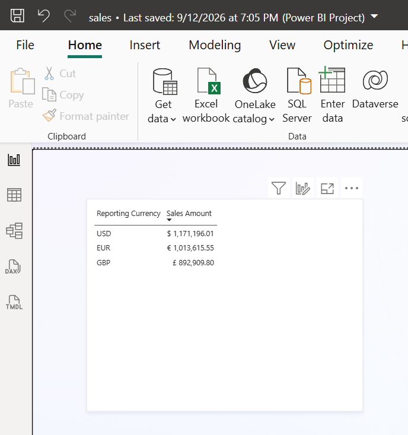

6. Commitez les changements.

#### Réflexion

* Observez comment l'agent a récupéré une source distante, analysé son schéma et l'a traduit en définitions de modèle sémantique.

### 1.6 Remettre en forme les pages du rapport

✅ **Objectif** : appliquer une mise en page cohérente à toutes les pages du rapport grâce aux outils de création de rapport.

#### Étapes

1. Ouvrez la page « Sales » dans **Power BI Desktop** : la position et la taille des visuels ne sont pas homogènes.

	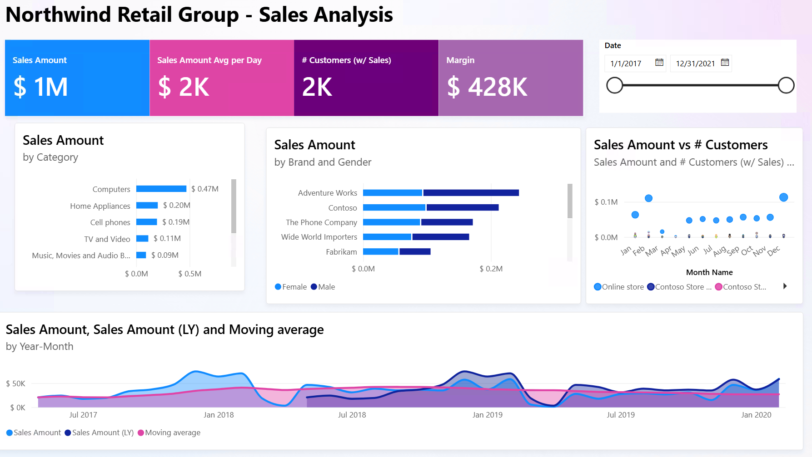

2. Cliquez sur **Enregistrer** dans Power BI Desktop pour qu'il ne reste aucune modification en attente.

> [!IMPORTANT]
> L'agent peut refuser de recharger le rapport si la CLI Power BI Desktop signale `unsavedChanges` : Desktop contient alors des modifications non enregistrées dans les fichiers PBIP, et s'arrêter évite d'écraser votre travail. Ici, on sait que l'agent est le seul à modifier le rapport, donc le prompt lui dit explicitement de continuer malgré l'avertissement.

3. Démarrez une **nouvelle session** (`/clear`) et choisissez **Opus**, effort **medium**.

4. Saisissez le prompt :

	```text
	Remove visual titles on all visuals of all pages in report `Sales.Report`.
	Ensure the grid layout of the report is consistent in terms of visual alignment and size:
	- Visual alignment between the grid rows
	- Spacing between visuals should be consistent
	- Visuals below the cards and slicers should have the same size on each grid row.
	Note: If CLI reports `hasUnsavedChanges=true` overwrite and continue with the reload for the screenshot validation.
	```

	**Résultat attendu**

	- L'agent charge la skill `powerbi-report-cli`.
	- Il lit et modifie les fichiers PBIR `*.json`.
	- Il utilise la CLI `powerbi-report-author` pour valider le schéma et prévisualiser le rapport par captures d'écran, via le [Power BI Desktop Bridge](https://learn.microsoft.com/en-us/power-bi/developer/agentic/power-bi-desktop-bridge-overview).
	- Claude Code sait lire les images : il peut regarder les captures et corriger lui-même un alignement raté.

5. Dans **Power BI Desktop**, vérifiez que les titres ont disparu et que les visuels sont alignés.

	Le rapport doit ressembler à ceci, sans être forcément identique :

	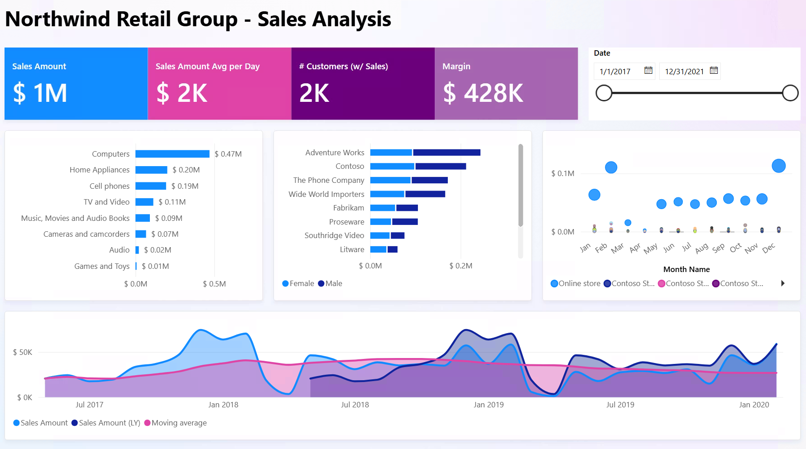

6. Commitez les changements.

#### Réflexion

* L'exemple modifie simplement deux pages, mais la même approche s'applique à des rapports plus gros ou à plusieurs rapports.
* Vous pourriez formaliser les standards de mise en page et de design de l'équipe en contexte agentique (par exemple une skill `.claude/skills/report-design-review/`), puis faire relire les rapports par l'agent en autonomie.
* Les outils CLI Power BI permettent à l'agent de valider le PBIR et de vérifier sur les captures de Power BI Desktop que le rendu correspond au résultat voulu.

---

## Partie 2 : Greenfield

Ici, vous partez de zéro. Vous créez un workspace Fabric, alimentez un Lakehouse avec un notebook, puis construisez un modèle sémantique Direct Lake et deux rapports avec **Claude Code**.

Cette partie n'utilise ni fichiers PBIP ni Power BI Desktop : elle **fonctionne sous Linux et macOS**. Tout passe par le MCP **distant** Power BI Authoring, hébergé par Microsoft.

### 2.1 Préparer le workspace Fabric

✅ **Objectif** : créer un workspace Fabric isolé et y charger un Lakehouse avec les tables de ventes d'exemple.

#### Étapes

1. Allez sur [Power BI](https://app.powerbi.com) et connectez-vous avec le compte de l'atelier.
2. **Workspaces** > **New workspace**.
3. Nommez le workspace selon cette convention :

	```text
	FabCon-Agentic-Lab2-[YourInitials]
	```

4. Affectez-le à la capacité Fabric/Premium disponible et cliquez sur **Apply**.
5. Dans le workspace, **New item** > **Notebook**.
6. Ouvrez [resources/notebook.py](resources/notebook.py) et copiez son contenu.
7. Collez-le dans la première cellule du notebook.
8. Exécutez la cellule (`CTRL+ENTER`) et attendez la fin.

	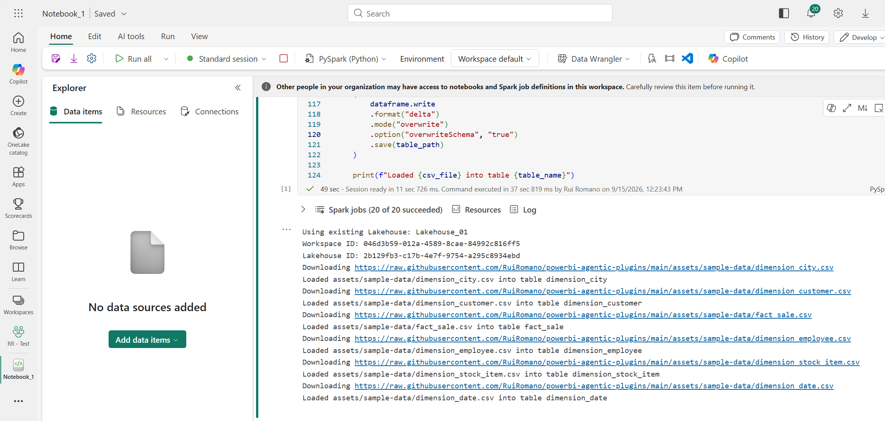

9. Revenez au workspace, actualisez la page et vérifiez qu'un Lakehouse `Lakehouse_01` a été créé.

	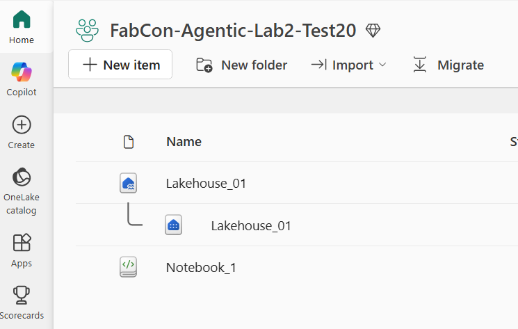

10. Ouvrez le Lakehouse et vérifiez qu'il contient :

	* `dimension_city`
	* `dimension_customer`
	* `dimension_date`
	* `dimension_employee`
	* `dimension_stock_item`
	* `fact_sale`

	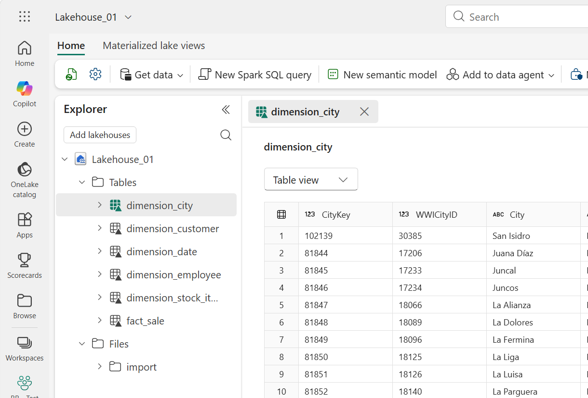

### 2.2 Brancher Claude Code au MCP distant

✅ **Objectif** : déclarer le MCP distant Power BI Authoring pour que l'agent travaille sur des modèles sémantiques Fabric, sans installation locale.

#### Étapes

1. Créez un dossier vide, par exemple `C:\FabCon\Lab2_Part2` (ou `~/FabCon/Lab2_Part2`).
2. Copiez-y [resources/part2/.mcp.json](resources/part2/.mcp.json) :

	```json
	{
	  "mcpServers": {
	    "powerbi-authoring-remote": {
	      "type": "http",
	      "url": "https://api.fabric.microsoft.com/v1/mcp/powerbi/authoring",
	      "headersHelper": "az account get-access-token --resource https://api.fabric.microsoft.com --query \"{Authorization: join(' ', ['Bearer', accessToken])}\" --output json --only-show-errors"
	    }
	  }
	}
	```

	Le `headersHelper` demande un jeton à Azure CLI à chaque connexion. L'authentification utilise donc le compte de `az login`, sans OAuth dans le navigateur.

	Vous pouvez aussi déclarer le serveur en ligne de commande. L'option `--scope project` écrit le même `.mcp.json` :

	```bash
	claude mcp add --scope project --transport http powerbi-authoring-remote https://api.fabric.microsoft.com/v1/mcp/powerbi/authoring
	```

	Il faut alors ajouter la ligne `headersHelper` à la main.

3. Copiez aussi [resources/team-rules.md](resources/team-rules.md) et [resources/contoso-design-standards.png](resources/contoso-design-standards.png) dans ce dossier.
4. Lancez `claude` dans le dossier. Au premier lancement, **approuvez** le serveur MCP du projet.
5. Tapez `/mcp` :
	- vérifiez que `powerbi-authoring-remote` est **connected** ;
	- sélectionnez le serveur local `plugin:powerbi-authoring:powerbi-modeling-mcp` et **désactivez-le** (*Disable*) pour cette session.

> [!IMPORTANT]
> Le MCP Power BI Authoring existe en version locale et en version distante (hébergée). La version locale est obligatoire avec Power BI Desktop ou des fichiers PBIP. Pour des modèles sémantiques dans Fabric, préférez la version distante : rien à installer, et c'est Microsoft qui la maintient. Voir [Power BI Authoring MCP server](https://learn.microsoft.com/power-bi/developer/mcp/power-bi-authoring-mcp).
>
> Le plugin `powerbi-authoring` fournit la version locale. **Évitez d'activer les deux en même temps.** L'agent verrait deux jeux d'outils qui se recoupent : il ne saurait pas lequel choisir, et chaque requête consommerait des tokens en plus. Choisissez le serveur distant pour les workspaces Fabric, et le local pour Power BI Desktop ou les fichiers PBIP.

> [!TIP]
> Autre option : le plugin `fabric-skills@fabric-collection` inclut déjà ce MCP distant (et d'autres serveurs Fabric) avec le même mécanisme Azure CLI. `claude plugin install fabric-skills@fabric-collection` suffit alors, mais il installe beaucoup plus de skills que nécessaire pour cet exercice.

### 2.3 Planifier et construire une solution Power BI complète

✅ **Objectif** : avec un seul prompt, planifier puis construire un modèle sémantique Direct Lake et deux rapports de direction. L'exercice montre comment skills, outils MCP et subagents en parallèle livrent une solution Power BI complète.

Vous relisez d'abord le plan complet. Une fois le plan approuvé, l'agent crée le modèle sémantique et confie chaque variante de rapport à un subagent distinct.

#### Étapes

1. Dans la session Claude Code du dossier `Lab2_Part2`, choisissez **Opus**, effort **medium** (`/model`).
2. Passez en **plan mode** avec `Shift+Tab` jusqu'à voir **plan mode on**, ou lancez directement `claude --permission-mode plan`.

> [!TIP]
> En **plan mode**, Claude Code est en lecture seule. Il explore le contexte, peut vous poser des questions et propose une approche avant de créer quoi que ce soit. Vous corrigez les hypothèses et validez la solution complète avant l'implémentation.

> [!TIP]
> Un dossier de travail délimite le projet pour l'agent : il y trouve les instructions du projet (`CLAUDE.md`) et les serveurs MCP propres au dossier (`.mcp.json`), et les sessions du même projet se retrouvent avec `/resume`. Ouvrir un dossier n'ajoute pas tous les fichiers au contexte : l'agent les lit au besoin.

3. Saisissez le prompt en remplaçant `[YOUR_WORKSPACE_NAME]` par le nom de votre workspace. La syntaxe `@fichier` ajoute les fichiers au contexte, image comprise :

	```text
	Create a Direct Lake semantic model named `Sales Model` using lakehouse `Lakehouse_01` in workspace `[YOUR_WORKSPACE_NAME]`.

	Include these tables:

	- `dimension_city`
	- `dimension_customer`
	- `dimension_date`
	- `dimension_employee`
	- `dimension_stock_item`
	- `fact_sale`

	Follow the development rules in @team-rules.md.

	Then create two separate, single-page executive Power BI reports using @contoso-design-standards.png design system:

	- **Style 1:** KPI cards across the top; trends and category breakdowns below.
	- **Style 2:** KPI cards on the left; trends and category breakdowns on the right.

	Assign one subagent to each report style, running in parallel. In the end, publish both reports separately to the Fabric workspace for my review.

	Do not modify the semantic model after creation. Use the available fields and measures, applying best judgment to select the most relevant executive insights.

	Use the `powerbi-report-author` headless browser for screenshots and save them in the working folder `./_screenshots/`.
	```

	**Résultat attendu pour le plan**

	- L'agent charge les skills de modèle sémantique et de rapport.
	- Il s'appuie sur [`team-rules.md`](resources/team-rules.md) pour les standards du modèle et sur [`contoso-design-standards.png`](resources/contoso-design-standards.png) pour le design des rapports.
	- Il utilise les outils disponibles, comme **Azure CLI** (`az rest`) ou le MCP distant, pour vérifier que le workspace et le Lakehouse existent et analyser le schéma.
	- Il produit un plan complet sans créer aucun élément Fabric.
	- Le plan crée le modèle avant les rapports et interdit aux rapports de modifier le modèle une fois terminé.
	- Le plan confie chaque style de rapport à un subagent isolé, pour construire les deux variantes en parallèle.

4. Relisez le plan. Vérifiez qu'il respecte les règles d'équipe, utilise les tables demandées, crée les deux styles de rapport et prévoit une validation du modèle et des rapports.
5. Ajustez le plan si besoin (répondez simplement dans le chat), puis **approuvez-le**. Choisissez le mode d'exécution proposé : avec *auto-accept*, l'agent déroule sans vous demander d'accord à chaque étape.

	**Résultat attendu pour l'implémentation**

	- L'agent trouve le workspace, le Lakehouse et les métadonnées nécessaires.
	- Il crée le modèle Direct Lake `Sales Model` sur les tables du Lakehouse via le MCP distant.
	- Le modèle respecte `team-rules.md` : noms de tables métier, mesures explicites, colonnes de base masquées, relations, et la table `About` si vous l'avez gardée.
	- Une fois le modèle terminé, l'agent lance **deux subagents** en parallèle, un par style de rapport.
	- Chaque subagent utilise le modèle sans le modifier et enregistre un rapport d'une page distinct dans le workspace.

> [!TIP]
> Chaque subagent Claude Code a son propre contexte. Il se concentre sur un style de rapport sans mélanger son travail avec celui de l'agent principal ou de l'autre subagent. Seul son compte rendu final remonte à l'agent principal, ce qui garde le contexte de ce dernier léger. Voir [Subagents](https://code.claude.com/docs/en/sub-agents).

6. Suivez l'exécution :

	- l'agent principal crée d'abord le modèle dans le Lakehouse avec les outils `mcp__powerbi-authoring-remote__…` ;
	- il lance ensuite deux appels **Agent** (un par style), avec pour chacun le contexte du modèle et la consigne de ne pas le modifier ;
	- `Ctrl+O` affiche la transcription détaillée : vous y voyez le prompt reçu par chaque subagent et le travail qu'il a fait ;
	- chaque subagent utilise la skill de création de rapport pour construire et prévisualiser son rapport avant de le déployer.

7. Le modèle et les deux rapports doivent maintenant être publiés dans votre workspace.

	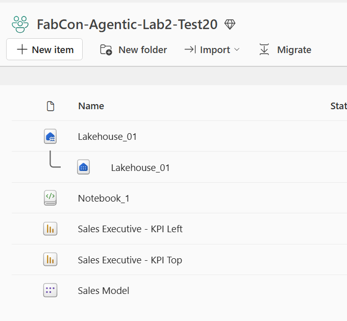

8. Ouvrez `Sales Model` dans le workspace. Vérifiez que les tables, relations, colonnes de base masquées, mesures explicites et la table `About` respectent les règles d'équipe.

	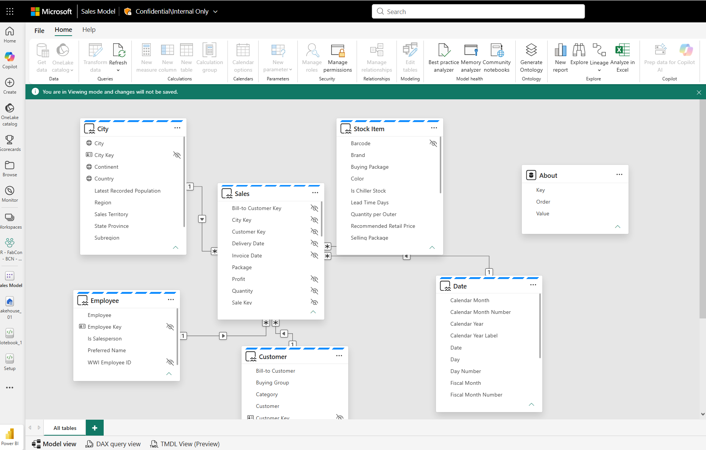

9. Ouvrez les deux rapports dans le portail Fabric. Vérifiez que chacun a une seule page, suit sa mise en page et respecte les standards de design. Comparez les deux variantes, ainsi que les captures dans `./_screenshots/`.

	| Style 1 | Style 2 |
	| --- | --- |
	| 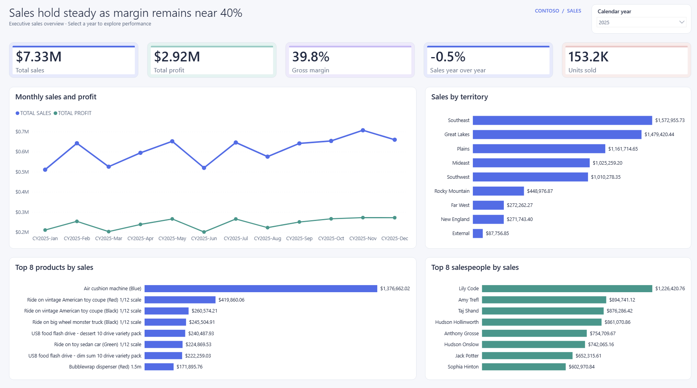 | 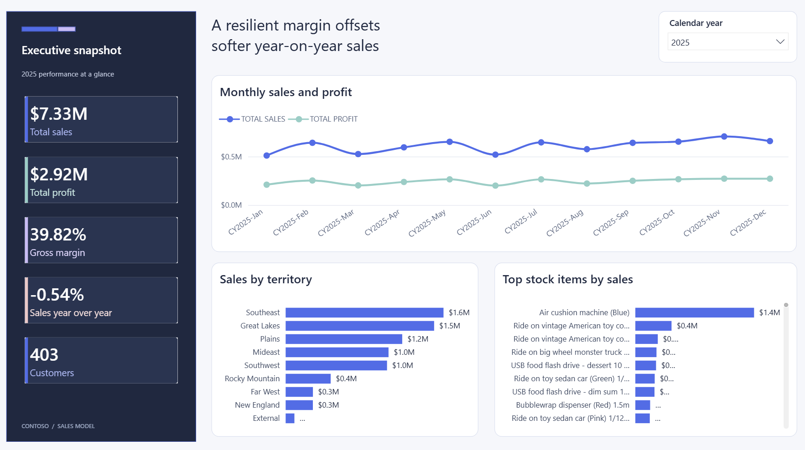 |

10. Regardez ce que la session a consommé :

	- `/cost` : coût et durée de la session, subagents compris (utilisateurs API) ;
	- `/context` : occupation de la fenêtre de contexte ;
	- `/usage` : consommation de votre abonnement (Pro/Max).

#### Réflexion

* Comment le temps et le coût de l'agent se comparent-ils à la réalisation de toute la tâche par vous-même ?
* Quelles instructions ajouteriez-vous au prompt, à `team-rules.md` ou à un autre fichier de contexte pour que l'agent atteigne vos standards de qualité ?
* L'agent doit comprendre la source de données pour construire un modèle utile. Ici, il inspecte le schéma du Lakehouse via les API Fabric. Avec d'autres sources, donnez-lui un moyen de s'y connecter et de l'inspecter, ou fournissez un contexte (fichier Markdown ou CSV décrivant les tables, colonnes et relations).
* En projet réel, faites travailler l'agent sur un workspace de développement, puis promouvez les changements relus avec [Fabric Git integration](https://learn.microsoft.com/en-us/fabric/cicd/git-integration/intro-to-git-integration) et [Fabric CI/CD](https://learn.microsoft.com/en-us/fabric/cicd/cicd-overview). Ne pointez jamais un agent directement sur un workspace de production.

## ✅ Bilan

Vous savez maintenant :

* Relire, versionner et annuler avec Git les changements faits par un agent
* Guider l'agent avec des instructions (`CLAUDE.md` / `AGENTS.md`), des skills et du contexte projet stockés avec le code
* Combiner des skills, qui décrivent la façon de travailler, et des outils MCP, qui font et valident le travail
* Séparer planification et implémentation (plan mode) pour relire une approche avant toute modification
* Choisir un modèle (Opus, Sonnet, Haiku) selon le raisonnement, le coût et le besoin de chaque tâche
* Utiliser des sessions distinctes (`/clear`, `/resume`) pour que les tâches ne s'influencent pas
* Utiliser des subagents à contexte isolé pour explorer des approches indépendantes en parallèle
* Travailler en environnement de développement et promouvoir des changements relus, sans jamais cibler la production
* Utiliser le même flux agentique dans le terminal comme dans VS Code

## Liens utiles

* [Power BI Desktop projects (PBIP)](https://learn.microsoft.com/power-bi/developer/projects/projects-overview)
* [Power BI MCP servers](https://learn.microsoft.com/en-us/power-bi/developer/mcp/mcp-servers-overview)
* [Skills for Fabric GitHub repo](https://github.com/microsoft/skills-for-fabric) (voir `mcp-setup/README.md` pour Claude Code)
* [Direct Lake overview](https://learn.microsoft.com/fabric/fundamentals/direct-lake-overview)
* [Model Context Protocol](https://modelcontextprotocol.io/)
* [Claude Code : plugins](https://code.claude.com/docs/en/plugins), [skills](https://code.claude.com/docs/en/skills), [MCP](https://code.claude.com/docs/en/mcp), [subagents](https://code.claude.com/docs/en/sub-agents), [memory / CLAUDE.md](https://code.claude.com/docs/en/memory)
* [Agent Skills spec](https://agentskills.io/specification)
* [Tabular Editor - Get Started with Agentic Development](https://tabulareditor.com/blog/how-to-get-started-with-agentic-development-for-business-intelligence)
* [Tabular Editor - Pick the right AI model](https://tabulareditor.com/blog/picking-the-ai-model-for-the-task)
* [Git cheat-sheet](https://git-scm.com/cheat-sheet)
