# Lab 3 - Build Data Apps with Fabric (édition Claude Code)

⏱️ **Durée totale :** 90 minutes

> [!IMPORTANT]
> Ce lab utilise des prompts avec des outils d'IA. Les réponses peuvent différer des exemples, même avec le même prompt. Après chaque exercice, comparez votre résultat avec le **Résultat attendu** avant de continuer.

## Vue d'ensemble

Ce lab emmène le développement agentique au-delà de la modélisation, vers la création d'applications. À partir d'un modèle sémantique existant, vous utilisez les **Fabric Data Apps** et des prompts en langage naturel dans **Claude Code** pour générer, personnaliser et affiner des applications analytiques sur mesure.

## Ce que vous allez apprendre

- Créer une **Fabric Data App** à partir d'un modèle sémantique
- Générer une application avec des prompts en langage naturel
- Transformer une inspiration visuelle en application de données personnalisée
- Affiner une application générée par l'IA pour un public précis
- Comprendre ce qui distingue les Fabric Data Apps de la création classique de rapports Power BI

## Structure du lab

| Section | Objectif |
| --- | --- |
| [Prérequis](#prérequis) | Vérifier outils, capacité, accès au modèle et paramètres du tenant |
| [0. Préparer l'environnement](#0-créer-le-workspace-lapp-et-importer-le-modèle) | Workspace isolé, modèle d'exemple, Fabric App et projet local |
| [1. Première itération](#1-créer-la-première-itération-de-la-fabric-app) | Connecter, générer et déployer une première version |
| [2. Itérer](#2-itérer-sur-la-fabric-app) | Sélection interactive, notes de coaching et charte Contoso |
| [3. Explorer](#3-explorer-et-personnaliser) | Tester des scénarios créatifs |

## Prérequis

Avant de commencer, vérifiez que vous avez :

* Accès au tenant Fabric de l'atelier, avec le droit de créer un workspace
* Une capacité Fabric affectable à votre workspace
* La charge de travail **Fabric Apps (preview)** activée pour votre compte par un administrateur du tenant
* Le fichier PBIX **Contoso Sales** fourni par l'atelier
* Un navigateur récent (Edge, Chrome ou Firefox)
* **Claude Code**, avec un compte Claude actif (voir les [prérequis](../pre-requisites.md))
* [Node.js et npm](https://nodejs.org/en/download/)
* Azure CLI

Utilisez le modèle sémantique **Contoso Sales** fourni plutôt que l'un des vôtres : les prompts, résultats attendus et vérifications restent ainsi cohérents pour tous les participants.

> [!NOTE]
> Ce lab fonctionne sous Windows, Linux et macOS. Les commandes sont indiquées pour PowerShell et bash quand elles diffèrent.

## Préparer l'environnement

### Se connecter avec Azure CLI

1. Ouvrez un terminal.
2. Connectez-vous avec le compte Fabric :

	```bash
	az login --allow-no-subscriptions
	```

	Le compte Fabric de l'atelier n'a **pas d'abonnement Azure**. Sans `--allow-no-subscriptions`, `az login` affiche `No subscriptions found` et ne crée aucune session : `az account show` répond alors `Please run 'az login'`. Pour cibler directement le tenant de l'atelier :

	```bash
	az login --tenant 64a5d9e8-a2d2-4914-bba4-4840b3732a7c --allow-no-subscriptions
	```

	> [!TIP]
	> Si la fenêtre de sélection de compte se ferme dès que vous cliquez sur un autre compte que celui déjà connecté (session SSO qui interfère), ajoutez `--use-device-code` : un code s'affiche dans le terminal, à saisir sur https://microsoft.com/devicelogin, sans passer par le sélecteur de comptes du navigateur.
	>
	> ```bash
	> az login --tenant 64a5d9e8-a2d2-4914-bba4-4840b3732a7c --allow-no-subscriptions --use-device-code
	> ```

3. Suivez la connexion dans le navigateur, puis revenez au terminal.
4. Vérifiez le compte actif :

	```bash
	az account show
	az account get-access-token --resource https://api.fabric.microsoft.com --query expiresOn -o tsv
	```

	La seconde commande doit afficher une date d'expiration : c'est ce jeton qu'utilisent les outils Power BI et le MCP distant.

	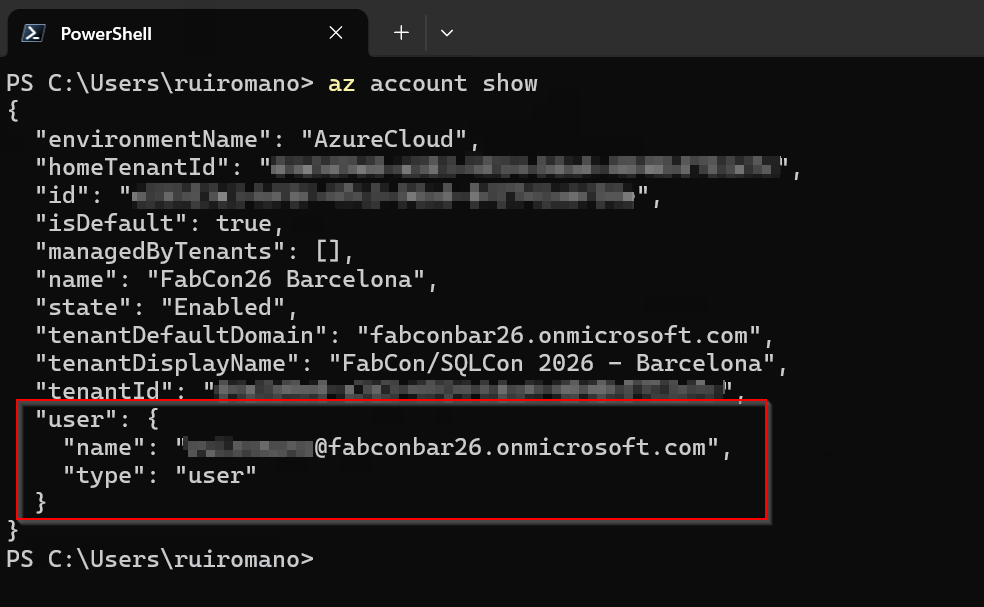

## 0. Créer le workspace, l'app et importer le modèle

✅ **Objectif** : créer un workspace Fabric isolé, y importer le PBIX de l'atelier, créer une Fabric App et préparer un projet local.

### Créer un workspace

1. Allez sur [Power BI](https://app.powerbi.com) et connectez-vous avec le compte de l'atelier.
2. **Workspaces** > **New workspace**.
3. Nommez le workspace selon cette convention :

	```text
	FabCon-Agentic-Lab3-[YourInitials]
	```

4. Affectez-le à la capacité Fabric/Premium disponible et cliquez sur **Apply**.
5. Attendez la création du workspace. Utilisez-le pendant tout le lab, pour travailler dans un environnement propre et isolé.

### Importer le modèle de l'atelier

1. Téléchargez [resources/Contoso Sales.pbix](resources/Contoso%20Sales.pbix) dans votre dossier **Téléchargements**.
2. Dans le workspace, cliquez sur **Import** dans la barre d'outils.
3. Choisissez **Report, Paginated Report or Workbook**.
4. Choisissez **From this computer**.

	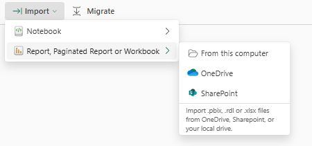

5. Sélectionnez `Contoso Sales.pbix` dans **Téléchargements**.
6. Cliquez sur **Open** et attendez la fin de l'import.

### Vérifier le modèle

1. Vérifiez qu'un rapport et un modèle sémantique apparaissent dans le workspace.
2. Vérifiez que le modèle s'appelle **Contoso Sales**.
3. Ouvrez le modèle et vérifiez qu'il se charge sans erreur.
4. Ne modifiez rien pour l'instant.

### Créer une Fabric App

1. Revenez au workspace qui contient le modèle **Contoso Sales**.
2. Cliquez sur **New item** en haut à gauche.

	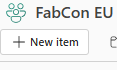

3. Dans le volet, choisissez **All items**.
4. Tapez `App` dans la recherche.
5. Choisissez **App (preview)**.

	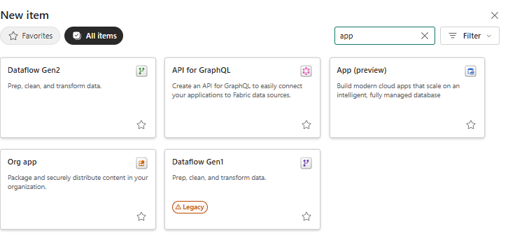

6. Dans la boîte **New App**, donnez un nom à l'app, par exemple `Contoso Sales App`.
7. Vérifiez que **Location** correspond à votre workspace.
8. Cliquez sur **Create**.

	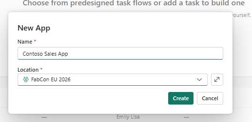

9. Sur la page des modèles, choisissez **Data App**.

	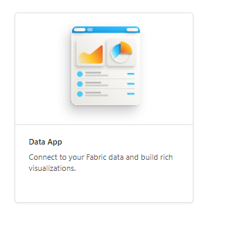

> [!Note]
> La page **Overview** de votre Fabric App doit s'afficher, avec une section **Getting started** : ouvrir un terminal, initialiser le projet, modifier l'app et publier. Une URL publique peut aussi apparaître en haut de la page. N'exécutez et ne copiez encore aucune commande : les étapes suivantes vous guident dans le bon ordre.

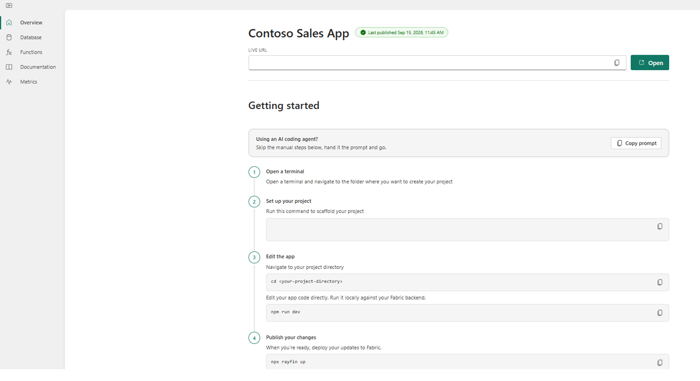

### Créer le dossier du projet et lancer Claude Code

1. Créez un dossier local pour le projet, par exemple :

	```text
	C:\FabCon\Lab3        (Windows)
	~/FabCon/Lab3         (Linux / macOS)
	```

2. Ouvrez **deux terminaux** dans ce dossier :
	- **Terminal A** : pour Claude Code ;
	- **Terminal B** : pour les commandes longues (scaffolding, serveur de dev `npm run dev`).

	Si vous utilisez VS Code, ouvrez le dossier (`code .`), lancez Claude Code depuis l'extension, puis ouvrez un terminal intégré (`` Ctrl+` ``) pour le terminal B.

3. Dans le terminal A, lancez Claude Code :

	```bash
	claude
	```

4. Choisissez le modèle avec `/model` : **Opus**, effort **medium**.

### Initialiser et démarrer la Fabric App

1. Revenez sur votre Fabric App dans le portail Fabric.
2. Dans **Getting started**, repérez l'**étape 2** et copiez la commande de scaffolding.

	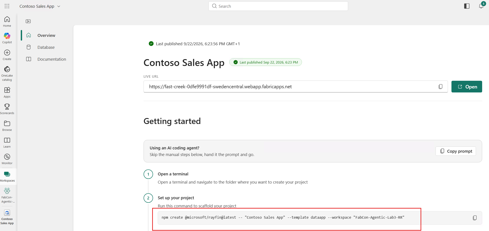

3. Collez-la dans le **terminal B** et appuyez sur **Entrée**.

	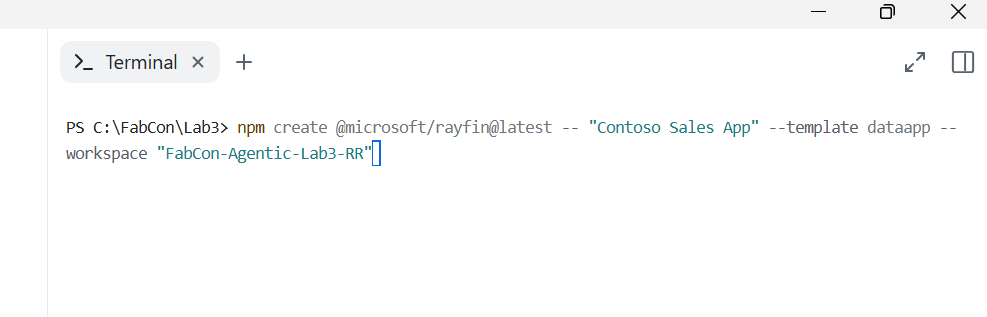

	**Remarque :** utilisez la commande générée pour **votre** Fabric App. Le nom de l'app, le nom du workspace et l'URL de base de l'API diffèrent de l'exemple.

	Si on vous le demande, approuvez les autorisations, confirmations ou connexions nécessaires.

	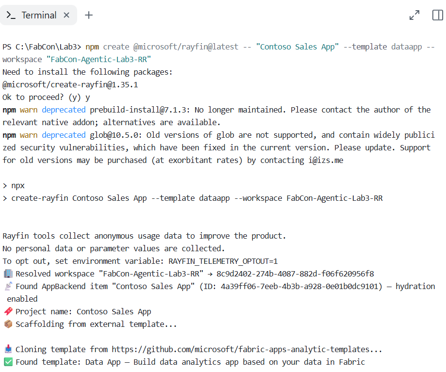

> [!TIP]
> Vous pouvez aussi lancer la commande depuis Claude Code en la préfixant par `!` (mode bash), par exemple `! npx ...`. La sortie reste alors dans le contexte de la session et Claude la voit. Ce n'est pas le cas si vous la lancez dans le terminal B.

4. Une fois le scaffolding terminé, allez dans le projet généré et démarrez l'app, toujours dans le terminal B :

	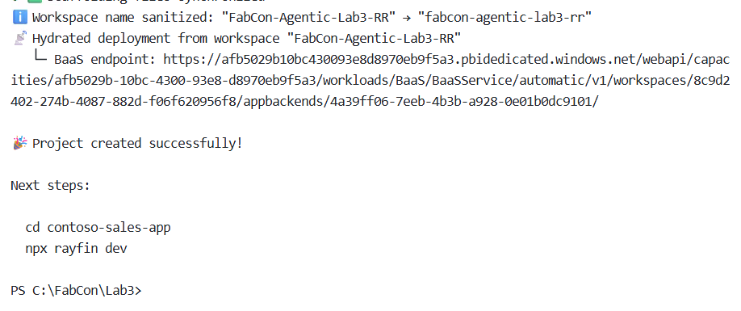

	```bash
	cd contoso-sales-app
	npm run dev
	```

	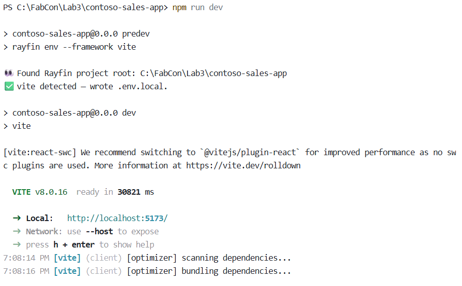

	Si on vous le demande, approuvez les autorisations ou confirmations nécessaires.

5. Dans le terminal A, placez Claude Code dans le projet généré. Deux possibilités :
	- quittez (`/exit`) et relancez `claude` depuis `contoso-sales-app` ;
	- ou restez dans le dossier parent : Claude trouvera le sous-dossier tout seul.

> [!TIP]
> Si le projet généré contient un `AGENTS.md` et pas de `CLAUDE.md`, créez un `CLAUDE.md` avec une seule ligne `@AGENTS.md` pour que Claude Code charge ces instructions. Vous pouvez aussi lancer `/init`.

### Résultat attendu

Vous devez maintenant avoir :

* Un workspace Fabric propre nommé `FabCon-Agentic-Lab3-[YourInitials]`
* Le rapport et le modèle Contoso Sales dans ce workspace
* Une nouvelle Fabric App basée sur le modèle **Data App**
* Une session Claude Code ouverte sur le dossier du projet
* Un projet Fabric Data App initialisé et lancé en local

## 1. Créer la première itération de la Fabric App

✅ **Objectif** : connecter la Fabric App au modèle Contoso Sales et créer une première expérience d'analyse des ventes à coups de prompts dans Claude Code.

### Étapes

1. Ouvrez le modèle **Contoso Sales** dans le portail Fabric et copiez son URL complète depuis la barre d'adresse. Dans Claude Code, saisissez :

	```text
	connect my data app to this semantic model : [URL_TO_YOUR_SEMANTIC_MODEL]
	```

	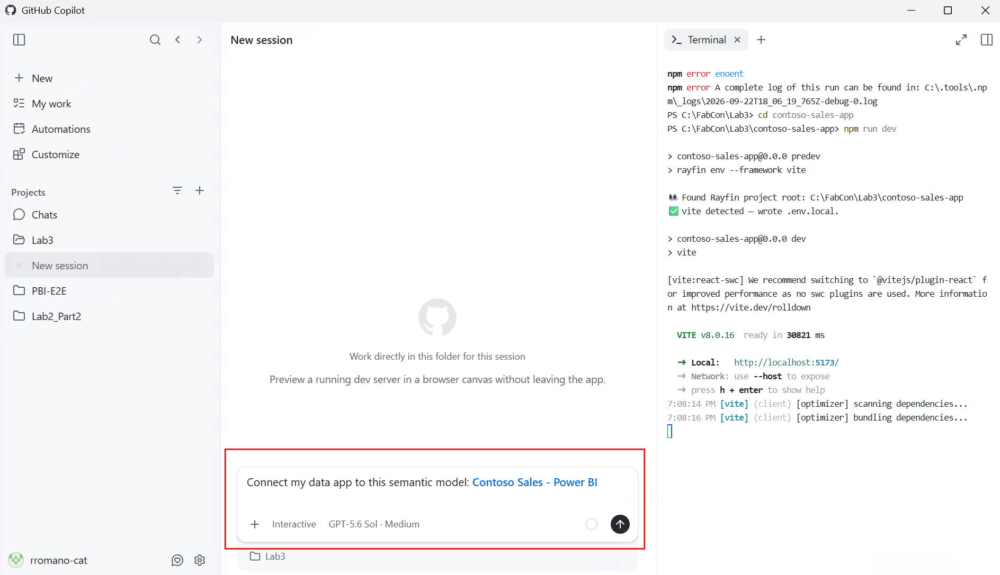

> [!Important]
> Collez l'URL **complète**, en texte brut. Elle contient les identifiants du modèle sémantique et du workspace dont Claude Code a besoin pour connecter l'app au bon modèle.

2. Une fois la connexion faite, saisissez le prompt suivant et laissez Claude lancer les commandes nécessaires :

	```text
	Build and deploy a polished sales analytics app for a Global Sales Manager using the connected semantic model. 
	Analyze store performance with KPIs for Total Sales, Gross Profit, Gross Margin %, Units Sold, and Sales per Unit. 
	Create a responsive store-level scatter plot of Sales per Unit vs. 
	Gross Margin %, with labeled performance quadrants. 
	Highlight top performers, outliers, and improvement opportunities, then deploy the app to Fabric.
	```

> [!NOTE]
> Si vous oubliez une commande, Claude Code sait souvent la retrouver et l'exécuter. Le prompt ci-dessus ne mentionne pas `npx rayfin up`, mais Claude le déduit de la demande de déploiement dans Fabric. À vous d'arbitrer : le langage naturel est plus pratique, lancer vous-même une commande connue (par exemple `! npx rayfin up`) consomme moins de tokens.

> [!TIP]
> Pour éviter une demande d'accord à chaque `npm` ou `npx`, choisissez **Yes, and don't ask again** à la première demande, ou passez en mode *accept edits* avec `Shift+Tab`.

3. Quand Claude Code affiche le lien de l'app dans le portail Fabric, ouvrez-le.

> [!NOTE]
> La capture ci-dessous est un exemple de ce que ce prompt peut produire. Le prompt laisse des choix de design et d'implémentation ouverts, donc votre app peut différer de l'exemple et de celles des autres participants. Un prompt vague donne vite une Fabric App utile. Pour affiner, vous pouvez :
>
> 1. écrire une spécification Markdown détaillée des besoins, avec du contexte (voir l'exemple [`Contoso Sales App Requirements.md`](resources/Contoso%20Sales%20App%20Requirements.md)) ;
> 2. passer en **plan mode** (`Shift+Tab`) pour relire et itérer sur les besoins avant l'implémentation ;
> 3. continuer à affiner la première version par des prompts, comme dans la section suivante.

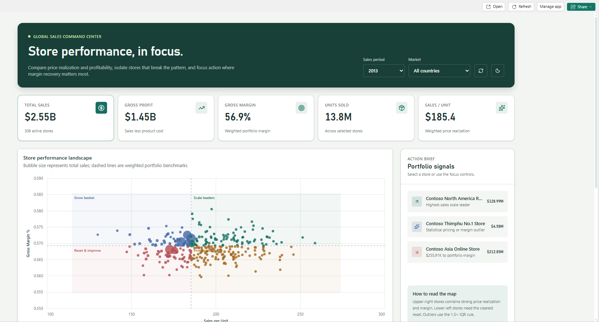

### Résultat attendu

Vous devez maintenant avoir :

* Une connexion au modèle Contoso Sales
* Une première expérience d'analyse des ventes pour des responsables commerciaux internationaux
* Une app déployée qui s'ouvre dans le portail Fabric
* Des indicateurs de performance par magasin qui font ressortir les meilleurs, les cas atypiques et les pistes d'amélioration

### Réflexion

* Combien de temps vous faudrait-il pour créer à la main un rapport ou un tableau de bord équivalent ?

## 2. Itérer sur la Fabric App

✅ **Objectif** : affiner la première version en ajoutant la sélection interactive, des notes de coaching par magasin et des thèmes Contoso.

### Rendre le nuage de points interactif

1. Saisissez dans Claude Code :

	```text
	Make the scatter plot fully interactive. 
	Allow selecting individual stores or multiple stores using rectangle and lasso selection, and use those selections to cross-filter the entire app. 
	Include a Clear Selection action alongside the selection actions so users can quickly return to the unfiltered view. 
	Keep the look and feel of the scatter plot clean and not too busy.
	```

2. Attendez la fin, puis actualisez l'app dans le portail Fabric (ou ouvrez le lien Fabric donné dans la réponse).

> [!NOTE]
> La capture ci-dessous n'est qu'un exemple. Le prompt laisse des détails ouverts, donc votre résultat sera probablement différent, y compris de celui des autres participants.

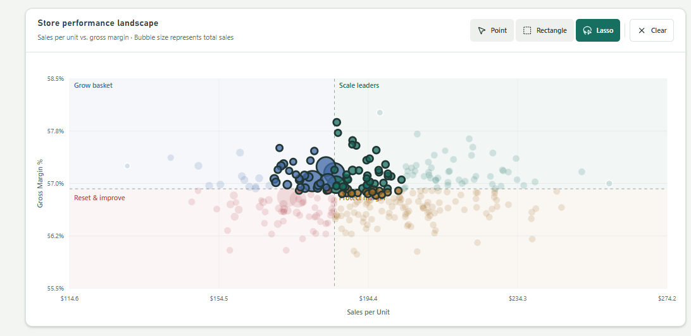

3. Testez la sélection d'un magasin, la sélection de plusieurs magasins au rectangle et au lasso, puis la réinitialisation. Vérifiez que chaque sélection filtre toute l'app et que **Clear Selection** rétablit la vue complète.

> [!NOTE]
> En cas d'erreur, de comportement inattendu ou de changement souhaité, décrivez clairement à Claude le comportement indésirable et le résultat attendu. Il doit pouvoir diagnostiquer et corriger. Une capture d'écran collée dans la session (`Ctrl+V`, ou glisser-déposer) l'aide beaucoup.

#### Réflexion

* Quelles étapes et compétences faudrait-il aujourd'hui pour construire un visuel aussi personnalisé dans un rapport Power BI ?
* Quelles autres interactions sur mesure pourriez-vous créer facilement en langage naturel dans une Fabric App ?

### Ajouter des notes de coaching par magasin

1. Saisissez dans Claude Code :

	```text
	Add in-app coaching notes for stores.
	Allow the ability within this app to create, view, and track notes, action items, and next steps for individual stores, with a historical log of entries.
	Support adding notes to multiple selected stores at once.
	```

2. Attendez la fin, puis actualisez l'app dans le portail Fabric.

> [!NOTE]
> La capture ci-dessous n'est qu'un exemple du comportement possible. Votre résultat sera probablement différent.

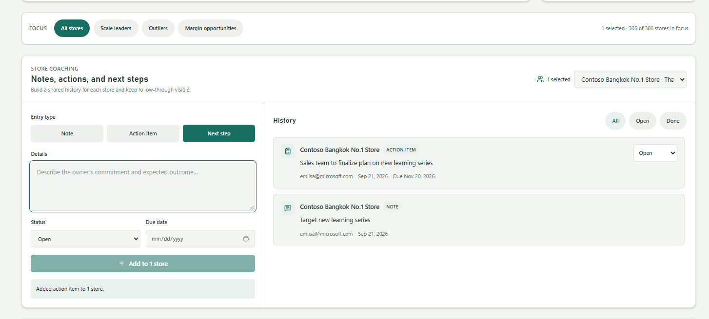

3. Vérifiez que l'app permet de voir et d'ajouter des notes de coaching. Créez une note pour un magasin, puis pour plusieurs magasins sélectionnés, et vérifiez que notes, actions et prochaines étapes apparaissent dans l'historique.

#### Réflexion

* En quoi l'écriture de données (write-back) transforme-t-elle une app d'analyse en outil opérationnel ?
* Quelles autres actions d'écriture utiles les utilisateurs pourraient-ils faire directement dans une Fabric Data App ?

### Appliquer la charte graphique Contoso

1. Donnez l'image [resources/contoso-design-standards.png](resources/contoso-design-standards.png) à Claude Code :
	- avec une référence `@` si le fichier est dans le dossier du projet (copiez-le à la racine) ;
	- en collant l'image (`Ctrl+V`) ;
	- ou en faisant glisser le fichier dans le terminal ou le panneau de l'extension VS Code.
2. Saisissez le prompt :

	```text
	Restyle the sales dashboard to align with the attached Contoso brand guide (@contoso-design-standards.png) while preserving all functionality.
	Allow users to switch the app background to any color from the brand palette, with each theme automatically adjusting colors, contrast, and visuals to remain readable, cohesive, and on-brand.
	```

3. Attendez la fin, puis actualisez l'app dans le portail Fabric.

> [!NOTE]
> La capture ci-dessous n'est qu'un exemple de rendu avec la charte Contoso. Votre résultat sera probablement différent.

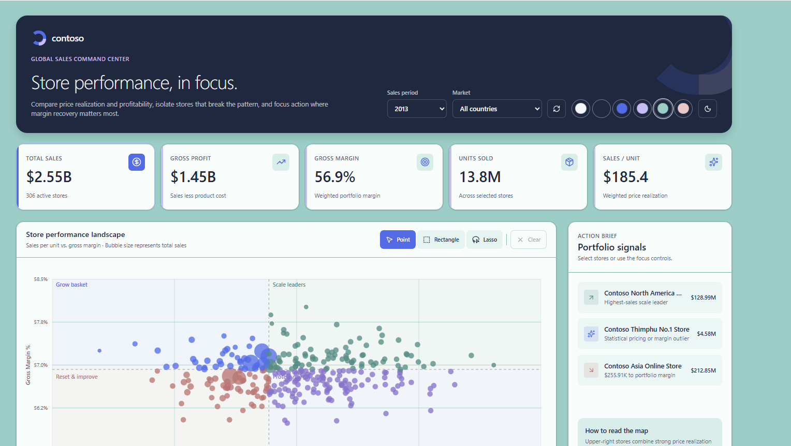

4. Testez chaque fond de la palette. Vérifiez que textes, contrôles et visuels restent lisibles et cohérents, et que la sélection sur le nuage de points et les notes de coaching fonctionnent toujours.

#### Réflexion

* Claude Code a-t-il bien suivi la charte fournie ? Que préciseriez-vous dans un prochain prompt ?
* En quoi une référence visuelle a-t-elle enrichi le contexte de Claude Code ?
* Quels autres fichiers ou éléments de contexte métier aideraient Claude Code à produire une app plus sur mesure ?

### Résultat attendu

La Fabric Data App mise à jour doit offrir :

* La sélection des magasins un par un, au rectangle et au lasso, avec filtrage de toute l'app
* Une action **Clear Selection** qui rétablit la vue complète
* Des notes de coaching, actions, prochaines étapes et un historique, pour un ou plusieurs magasins, consultables et modifiables dans l'app
* Un style conforme à la charte Contoso
* Des fonds issus de la palette de la charte, avec un contraste lisible et des visuels cohérents
* Toutes les fonctionnalités de la première itération

## 3. Explorer et personnaliser

✅ **Objectif** : tester un nouveau scénario ou un changement de design, et affiner l'app par des prompts en langage naturel.

La souplesse et la personnalisation sont des atouts des Fabric Apps. Profitez du temps restant pour être créatif et voir ce qui fonctionne.

### Étapes

1. Parcourez la [Fabric Apps Gallery](https://community.fabric.microsoft.com/category/pbi_comm_galleries/discussions/pbi_fabricappsgallery) pour trouver des idées.
2. Choisissez un autre scénario ou un changement original qui vous intéresse.
3. Demandez à **Claude Code** de mettre à jour et de déployer votre Fabric App. Pour un changement important, commencez en **plan mode**.
4. Testez le changement et continuez à itérer.

> [!TIP]
> Pour comparer plusieurs pistes de design, demandez à Claude de lancer des **subagents** en parallèle, chacun travaillant dans son propre worktree Git. Vous choisissez ensuite la meilleure variante.

### Résultat attendu

Votre app déployée doit contenir :

* Au moins une personnalisation au-delà des itérations guidées
* L'expérience Contoso Sales existante, toujours fonctionnelle
* La version finale déployée dans Fabric

## ✅ Bilan

Vous avez :

* Utilisé **Claude Code** pour créer une Fabric Data App
* Connecté l'app au modèle sémantique et généré une expérience d'analyse des ventes pour un responsable commercial international
* Ajouté la sélection interactive des magasins, avec filtrage de toute l'app
* Ajouté des notes de coaching, actions, prochaines étapes et un historique pour un ou plusieurs magasins
* Appliqué la charte Contoso et testé des thèmes accessibles sur toute la palette

## À retenir

* Les Fabric Data Apps combinent des données Fabric gouvernées et des expériences souples, écrites en code.
* Le contexte du modèle sémantique et des prompts précis aident Claude Code à générer des applications pertinentes.
* Relire, tester et affiner les changements générés reste indispensable.

## Liens utiles

* [Fabric Apps Gallery | Microsoft Fabric Community](https://community.fabric.microsoft.com/category/pbi_comm_galleries/discussions/pbi_fabricappsgallery)
* [Fabric Data Apps template | Microsoft Learn](https://learn.microsoft.com/fabric/apps/data-apps-template)
* [Fabric Apps overview | Microsoft Learn](https://learn.microsoft.com/fabric/apps/overview)
* [Create a Fabric app | Microsoft Learn](https://learn.microsoft.com/fabric/apps/create-app)
* [Claude Code : modes de permission](https://code.claude.com/docs/en/iam)
